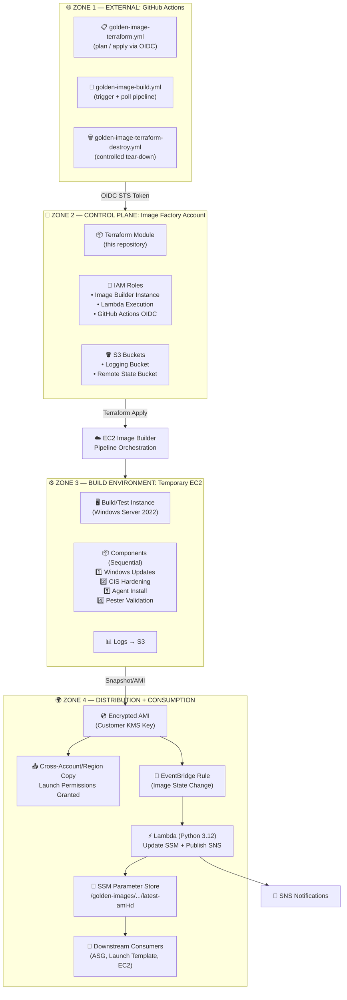
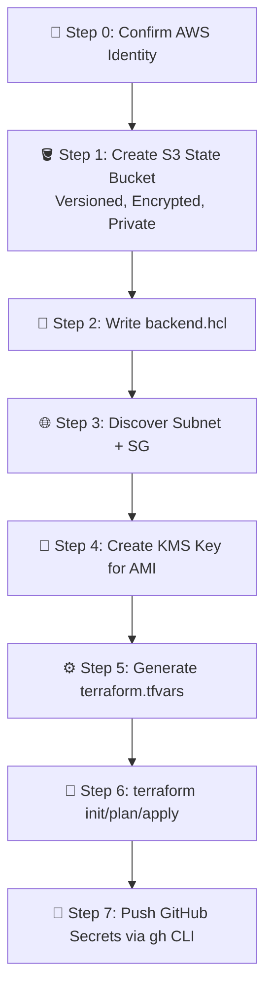
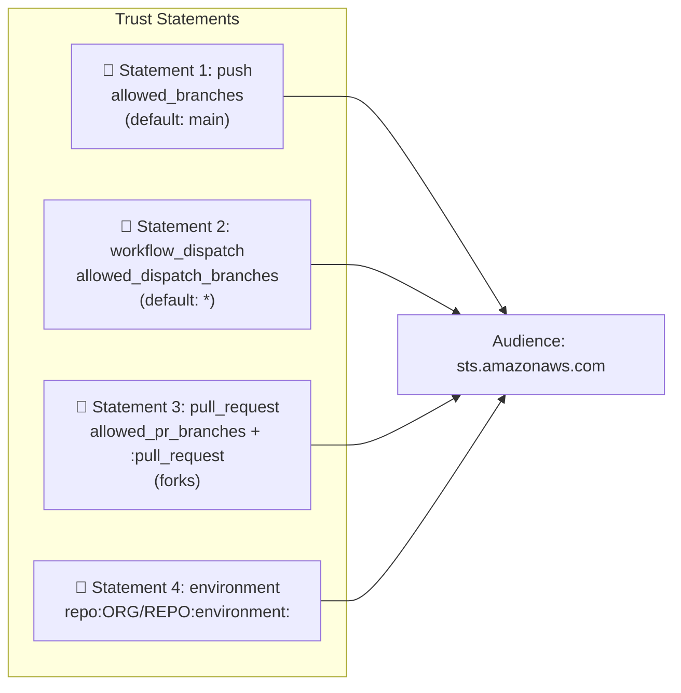

# 🏗️ Golden Image Pipeline — Windows Server 2022


> **Enterprise-grade golden image pipeline** for Windows Server 2022, built on **AWS EC2 Image Builder** and **Terraform**, automated end-to-end through **GitHub Actions** using short-lived **OIDC** credentials. Designed for hub-and-spoke landing zones with cross-account/region distribution.

---

## 📋 Table of Contents

| Section | Description |
|---------|-------------|
| [Architecture Overview](#-architecture-overview) | High-level design and data flow |
| [What This Pipeline Creates](#-what-this-pipeline-creates) | Complete resource inventory |
| [Prerequisites](#-prerequisites) | Required AWS resources and tooling |
| [Quick Start](#-quick-start) | Bootstrap → First build → Ongoing ops |
| [GitHub Actions Integration](#-github-actions-integration) | Workflows, secrets, OIDC trust policy |
| [Consuming the Golden AMI](#-consuming-the-golden-ami) | Downstream usage patterns |
| [Extending the Pipeline](#-extending-the-pipeline) | Add components, update Lambda, distribute |
| [Security Model](#-security-model) | Identity, encryption, network, operations |
| [Operational Runbook](#-operational-runbook) | Manual triggers, troubleshooting, teardown |
| [Known Gaps](#-known-gaps--extension-points) | Future enhancements |
| [References](#-references) | Deep-dive docs and external links |

---

## 🏛️ Architecture Overview

### Logical Zones



### Component Execution Order

| Phase | Order | Component | Purpose |
|-------|-------|-----------|---------|
| **Build** | 1️⃣ | `windows-updates` | Install latest Windows patches |
| **Build** | 2️⃣ | `cis-hardening` | Apply CIS Benchmark controls |
| **Build** | 3️⃣ | `agent-install` | Install/validate SSM + CloudWatch Agents |
| **Test** | 4️⃣ | `validation-test` | Pester suite: hardening, agents, services |

---

## 🏗️ What This Pipeline Creates

The Terraform module provisions and wires together a complete **Image Factory** in a central AWS account:

| Category | Resources Created |
|----------|-------------------|
| **🔐 Identity & Access** | GitHub OIDC Provider, GitHub Actions IAM Role (least-privilege), Image Builder Instance Role, Lambda Execution Role, Instance Profile |
| **☁️ EC2 Image Builder** | 4 Components, Image Recipe, Infrastructure Config, Distribution Config, Image Pipeline (scheduled) |
| **🪣 Storage** | S3 Logging Bucket (180-day lifecycle, public access blocked, service-principal policy) |
| **📝 Parameter Store** | SSM Parameter `/golden-images/<prefix>/latest-ami-id` (updated post-build) |
| **📡 Event-Driven** | EventBridge Rule (AVAILABLE/FAILED), Lambda Function, Lambda Permission |
| **🔔 Notifications** | SNS Topic (optional, for build success/failure alerts) |
| **🔑 Encryption** | Customer-managed KMS Key for AMI encryption (created out-of-band) |

**Total: ~27 AWS resources** managed as code.

---

## ✅ Prerequisites

### AWS Account & Network

| Resource | Requirement | Purpose |
|----------|-------------|---------|
| **Image Factory Account** | Dedicated AWS account | Hosts pipeline, IAM, build env, state bucket |
| **Private Subnet** | `subnet_id` with SSM VPC endpoints (`ssm`, `ssmmessages`, `ec2messages`) **OR** NAT/IGW egress | Image Builder controls instances via SSM only — no SSH/RDP |
| **Security Group(s)** | Outbound to SSM, S3, KMS, Image Builder endpoints | Attached to build instance |
| **KMS Key** | `kms_key_id` ARN with `kms:CreateGrant` for Image Builder, `kms:Decrypt` for spoke accounts | Encrypts AMI snapshots |
| **SNS Topic** | Optional but recommended for production | Build success/failure notifications |

### Distribution Targets

| Target | Variable | Notes |
|--------|----------|-------|
| Spoke Accounts (same region) | `distribution_accounts` | List of AWS account IDs |
| Cross-Region + Accounts | `distribution_regions` | Map: region → `{target_account_ids, ami_name}` |
| Cross-Region KMS | Per-region keys or grants | Required if spoke accounts use different keys |

### Source Control & Identity

| Item | Value |
|------|-------|
| GitHub Repository | `SinghWorld/b-aws-tf-gha-ec2-imagebuilder` (or your fork) |
| GitHub Environment | `golden-image-shared-services` (approval gate for plan/apply/destroy) |
| Base Image ARN | SSM alias: `arn:aws:imagebuilder:us-east-1:aws:image/windows-server-2022-english-full-base-x86/x.x.x` |

---

## 🛠️ Required Software & Tooling

### Local Development Machine

| Tool | Minimum Version | Purpose |
|------|-----------------|---------|
|  | **1.10.0** | S3-native state locking (`use_lockfile = true`) |
|  | **v2** | Auth, pipeline ARN lookup, manual triggers |
|  | **1.6+** | Parse AWS CLI JSON output |
|  | any | Rebuild Lambda deployment package |
|  | **4.0+** | Run bootstrap/destroy scripts |
|  | **2.30+** | Clone, push, PR workflow |
| OpenSSL | any | Compute SHA256 for Lambda hash |

### CI/CD Environment (GitHub Actions)

| Tool | Version | Provided By |
|------|---------|-------------|
| Terraform | 1.11.0 | `hashicorp/setup-terraform@v3` |
| AWS Credentials | OIDC Token | `aws-actions/configure-aws-credentials@v4` |
| AWS CLI | latest | Ubuntu runner base image |
| zip | any | Ubuntu runner base image |

---

## 🚀 Quick Start

### 1️⃣ First-Time Bootstrap (Recommended)

```bash
# From repository root
cd /home/dc-ops/b-aws-tf-gha-ec2-imagebuilder
bash golden-image-windows/scripts/bootstrap-sandbox.sh
```

**What the bootstrap script does:**



**After bootstrap completes, verify these GitHub Secrets exist:**
- `AWS_OIDC_ROLE_ARN`
- `TF_STATE_BUCKET`, `TF_STATE_REGION`, `TF_STATE_KEY`
- `GOLDEN_IMAGE_SUBNET_ID`, `GOLDEN_IMAGE_SG_IDS`, `GOLDEN_IMAGE_KMS_KEY_ARN`
- `GOLDEN_IMAGE_DISTRIBUTION_ACCOUNTS`, `GOLDEN_IMAGE_SNS_TOPIC_ARN`

### 2️⃣ Trigger First Build (Manual)

```bash
# Get pipeline ARN from Terraform output
PIPELINE_ARN=$(terraform -chdir=golden-image-windows output -raw pipeline_arn)

# Start the build
aws imagebuilder start-image-pipeline-execution \
  --image-pipeline-arn "$PIPELINE_ARN"
```

**Poll for completion:**
```bash
# Replace <arn> with the image-build-version-arn from start command
aws imagebuilder get-image \
  --image-build-version-arn <arn> \
  --query 'image.state.status' --output table
```

### 3️⃣ Alternative: Manual Terraform Apply

```bash
cd golden-image-windows
cp terraform.tfvars.example terraform.tfvars
# Edit terraform.tfvars with your values

terraform init -backend-config=backend.hcl
terraform validate
terraform fmt -check -recursive
terraform plan
terraform apply
```

---

## 🔄 GitHub Actions Integration

### Workflows Overview

| Workflow | Trigger | Purpose | Environment Gate |
|----------|---------|---------|------------------|
| `golden-image-terraform.yml` | PR, push to main, `workflow_dispatch` | `terraform plan` on PRs; `apply` on push to main | `golden-image-shared-services` |
| `golden-image-build.yml` | Push to main (components), `workflow_dispatch`, schedule | Start Image Builder pipeline, poll to completion | `golden-image-shared-services` |
| `golden-image-terraform-destroy.yml` | `workflow_dispatch` only | Controlled tear-down of all resources | `golden-image-shared-services` + `confirm_destroy=destroy` |

### Required GitHub Secrets

| Secret | Description | Set By |
|--------|-------------|--------|
| `AWS_OIDC_ROLE_ARN` | IAM role ARN for OIDC assumption | Bootstrap script / Manual |
| `TF_STATE_BUCKET` | S3 bucket for Terraform remote state | Bootstrap script |
| `TF_STATE_REGION` | Region of state bucket | Bootstrap script |
| `TF_STATE_KEY` | State object key (default: `golden-image-windows/terraform.tfstate`) | Bootstrap script |
| `GOLDEN_IMAGE_SUBNET_ID` | Build instance subnet ID | Bootstrap script |
| `GOLDEN_IMAGE_SG_IDS` | JSON array of security group IDs | Bootstrap script |
| `GOLDEN_IMAGE_KMS_KEY_ARN` | KMS key ARN for AMI encryption | Bootstrap script |
| `GOLDEN_IMAGE_DISTRIBUTION_ACCOUNTS` | JSON array of spoke account IDs | Manual / Bootstrap |
| `GOLDEN_IMAGE_SNS_TOPIC_ARN` | SNS topic ARN for notifications | Manual / Bootstrap |

### OIDC Trust Policy (Least Privilege)

The GitHub Actions role uses **5 trust policy statements**, each gated on `event_name`:



> **Key insight:** Widening `allowed_pr_branches` or `allowed_dispatch_branches` does **not** widen who can push to `main` and trigger `terraform apply`.

---

## 🎯 Consuming the Golden AMI

Downstream infrastructure **must** read the AMI ID from SSM Parameter Store — never hardcode:

```hcl
data "aws_ssm_parameter" "golden_ami" {
  name = "/golden-images/golden-win2022/latest-ami-id"
}

resource "aws_instance" "example" {
  ami           = data.aws_ssm_parameter.golden_ami.value
  instance_type = "t3.large"
}
```

**Contract guarantees:**
- ✅ Parameter updated **only on successful builds** (`AVAILABLE`)
- ✅ Failed builds leave previous known-good AMI in place
- ✅ Downstream workloads always point to a validated image

---

## 🔧 Extending the Pipeline

### Add a New Image Builder Component

```bash
# 1. Create component YAML
cat > golden-image-windows/components/my-component.yaml <<'EOF'
name: my-component
version: 1.0.0
description: "Custom component"
schemaVersion: 1.0
phases:
  - name: build
    steps:
      - name: MyStep
        action: ExecutePowerShell
        inputs:
          commands:
            - Write-Host "Hello from custom component"
EOF

# 2. Register in recipe.tf
resource "aws_imagebuilder_component" "my_component" {
  name         = "my-component"
  version      = "1.0.0"
  platform     = "Windows"
  data         = file("${path.module}/components/my-component.yaml")
}

# 3. Add to image recipe (ORDER MATTERS!)
resource "aws_imagebuilder_image_recipe" "this" {
  # ... existing config ...
  component {
    component_arn = aws_imagebuilder_component.my_component.arn
  }
}
```

### Update Lambda Function

```bash
cd golden-image-windows/lambda
# Edit index.py
vim index.py

# Rebuild deployment package
zip -j update_ssm_param.zip index.py

# Commit and push
git add update_ssm_param.zip
git commit -m "feat(lambda): update notification payload"
git push
```

The `golden-image-terraform.yml` workflow rebuilds the package, computes the new SHA256 hash, and passes it to `terraform apply`.

### Add Cross-Account/Region Distribution

```hcl
# In terraform.tfvars (via GitHub secrets)
distribution_accounts = ["111122223333", "444455556666"]

distribution_regions = {
  "us-west-2" = {
    target_account_ids = ["111122223333"]
    ami_name           = "golden-win2022-us-west-2-{{ imagebuilder:buildDate }}"
  }
}
```

Ensure KMS key policy grants `kms:Decrypt` to destination accounts, or use per-region keys with explicit grants.

---

## 🔒 Security Model

### Identity & Access

| Layer | Implementation |
|-------|----------------|
| **Authentication** | GitHub Actions → OIDC → STS AssumeRole (no long-lived keys) |
| **Authorization** | Branch-scoped (`allowed_branches`), Event-scoped (`event_name`), Environment-scoped (`environment:`) |
| **Least Privilege** | 12 logical IAM policy statements, resource-scoped where possible |
| **PassRole** | Scoped to exact instance profile + Lambda role, conditioned on service principal |

### Encryption

| Resource | Encryption |
|----------|------------|
| AMI Snapshots | Customer-managed KMS key (`kms_key_id`) |
| S3 Logs Bucket | SSE-S3 (AES256) + bucket policy restricting to `imagebuilder.amazonaws.com` |
| Terraform State | SSE-S3 + S3-native locking (`.tflock`) |
| SSM Parameter | AWS-managed encryption (Parameter Store default) |

### Network

- Build instances run in **private subnet** with **SSM VPC endpoints** or NAT/IGW
- **No SSH/RDP** — Image Builder uses SSM Session Manager exclusively
- S3 logs bucket: **Public access fully blocked**

### Operational Posture

| Control | Implementation |
|---------|----------------|
| Instance Termination | `terminate_instance_on_failure = true` |
| Log Retention | 180 days (configurable via lifecycle policy) |
| AMI Promotion | SSM parameter updated **only on success** |
| State Locking | S3-native (`.tflock` via conditional writes) — no DynamoDB |

---

## 📖 Operational Runbook

### Trigger Manual Build

**Option 1: GitHub Actions UI**
1. Navigate to **Actions → Golden Image - Trigger Build**
2. Click **Run workflow**
3. Optional: Enter reason
4. Click **Run workflow**

**Option 2: AWS CLI**
```bash
aws imagebuilder start-image-pipeline-execution \
  --image-pipeline-arn "$(terraform -chdir=golden-image-windows output -raw pipeline_arn)"
```

### View Build Logs

```bash
# List recent builds
aws imagebuilder list-image-build-versions \
  --image-version-arn "$(terraform -chdir=golden-image-windows output -raw recipe_arn)"

# Get detailed status
aws imagebuilder get-image \
  --image-build-version-arn <arn> \
  --query 'image.{State: state.status, Reason: state.reason, AMI: outputResources.amis[0].image}'
```

### Consume AMI in Downstream Terraform

```hcl
data "aws_ssm_parameter" "golden_ami" {
  name = "/golden-images/golden-win2022/latest-ami-id"
}

resource "aws_launch_template" "app" {
  image_id      = data.aws_ssm_parameter.golden_ami.value
  instance_type = "t3.large"
  # ...
}
```

### Teardown (Destruction)

**Via GitHub Actions (Recommended):**
1. Actions → **Golden Image - Terraform Destroy** → Run workflow
2. Input `confirm_destroy: destroy`
3. Provide reason
4. Approve in `golden-image-shared-services` environment

**Via Local Script:**
```bash
bash golden-image-windows/scripts/destroybootstrap-sandbox.sh
```

> ⚠️ **After destroy:** OIDC role no longer exists. Re-run `bootstrap-sandbox.sh` to recover.

---

## ⚠️ Known Gaps & Extension Points

| Gap | Recommended Approach |
|-----|----------------------|
| **Domain Join** | Add component for AD DS / Azure AD join at launch via SSM Association; keep golden image domain-agnostic |
| **EDR/AV Agent** | Replace placeholder in `agent-install.yaml` with real installer (pull binaries/tokens from S3 or Secrets Manager) |
| **Cross-Account KMS Grants** | Add explicit `kms:Grant` resources when spoke accounts are in different Organization or use different keys |
| **Multi-Version Support** | Duplicate module with different `name_prefix` + `base_image_arn` per OS version |
| **Full CIS Coverage** | Replace inline controls in `cis-hardening.yaml` with Microsoft's official CIS GPO baseline via `LGPO.exe`, or call DSC/Ansible from compliance-as-code repo |
| **Approval Gates** | Configure required reviewers on `golden-image-shared-services` GitHub Environment |

---

## 📚 References

| Document | Description |
|----------|-------------|
| [`docs/TECHNICAL_DOCUMENTATION.md`](docs/TECHNICAL_DOCUMENTATION.md) | **Deep-dive**: Architecture, security model, Terraform module reference, operational runbook |
| [`docs/architecture/`](docs/architecture/) | Draw.io architecture diagrams (editable) |
| [`docs/How-and-Where-to-start.md`](docs/How-and-Where-to-start.md) | Quick-reference getting started guide |
| [AWS EC2 Image Builder Docs](https://docs.aws.amazon.com/imagebuilder/) | Official user guide & API reference |
| [Terraform S3 Backend + Locking](https://developer.hashicorp.com/terraform/language/settings/backends/s3) | `use_lockfile` (Terraform 1.10+) |
| [GitHub Actions OIDC](https://docs.github.com/en/actions/security-for-github-actions/about-security-hardening-with-openid-connect) | Token claims: `sub`, `event_name`, `environment` |
| [CIS Windows Server 2022 Benchmark](https://www.cisecurity.org/benchmark/microsoft_windows_server) | Hardening controls reference |

---

## 🤝 Contributing

1. Fork the repository
2. Create a feature branch (`git checkout -b feature/amazing-change`)
3. Make your changes with tests/validation
4. Open a Pull Request → `golden-image-terraform.yml` runs plan automatically
5. After review, merge to `main` → apply runs automatically

---

## 📄 License

MIT License — see [LICENSE](LICENSE) for details.

---

*Built with ☁️ AWS, 🏗️ Terraform, 🔐 OIDC, and ❤️ for infrastructure automation.*