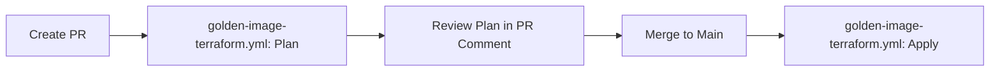
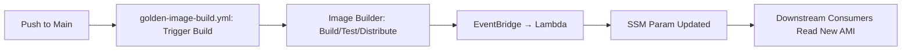
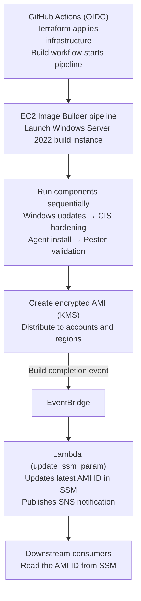

# How and Where to Start — Golden Image Pipeline

> **Enterprise Golden Image Pipeline for Windows Server 2022**  
> AWS EC2 Image Builder + Terraform + GitHub Actions OIDC

---

## 📁 Repository Structure

```
b-aws-tf-gha-ec2-imagebuilder/
├── .github/workflows/
│   ├── golden-image-build.yml            # Triggers Image Builder pipeline on component changes
│   ├── golden-image-terraform.yml        # Terraform plan/apply for infrastructure changes
│   └── golden-image-terraform-destroy.yml # Destroys all resources (manual only)
├── golden-image-windows/
│   ├── components/                       # Image Builder components (YAML)
│   │   ├── windows-updates.yaml          # Windows Updates installation
│   │   ├── cis-hardening.yaml            # CIS Benchmark hardening
│   │   ├── agent-install.yaml            # SSM Agent + CloudWatch Agent
│   │   └── validation-test.yaml          # Pester validation tests
│   ├── lambda/
│   │   ├── index.py                      # Lambda: updates SSM param + SNS on build completion
│   │   └── update_ssm_param.zip          # Pre-built deployment package
│   ├── scripts/
│   │   ├── bootstrap-sandbox.sh          # One-time sandbox bootstrap
│   │   └── destroybootstrap-sandbox.sh   # Sandbox teardown
│   ├── *.tf                              # Terraform modules (see table below)
│   ├── terraform.tfvars.example          # Template for terraform.tfvars
│   └── terraform.tfvars                  # Actual values (gitignored, from GitHub secrets)
├── docs/                                 # Architecture diagrams & technical docs
├── CLAUDE.md                             # Project instructions for Claude Code
└── README.md                             # Full documentation
```

---

## 🧩 Terraform Files (golden-image-windows/)

| File | Purpose |
|------|---------|
| `provider.tf` | AWS provider config, required_version, **S3 remote backend with native `.tflock` locking** |
| `variables.tf` | Input variables (subnet, SG, KMS, accounts, GitHub OIDC, state bucket) |
| `oidc-variables.tf` | OIDC-specific variables (branches, environments, role name) |
| `iam.tf` | IAM roles: Image Builder instance role, instance profile |
| `recipe.tf` | Image recipe + 4 components (updates → CIS → agents → validation) |
| `infrastructure-configuration.tf` | Build instance config (subnet, SG, instance types, logging bucket) |
| `distribution-configuration.tf` | Cross-account/region AMI distribution, KMS encryption, launch permissions |
| `pipeline.tf` | Image pipeline + schedule + SSM parameter for latest AMI |
| `eventbridge.tf` | EventBridge rule + Lambda to update SSM param on build completion |
| `oidc-github-actions.tf` | GitHub OIDC provider + IAM role with least-privilege policy |
| `outputs.tf` | Pipeline ARN, recipe ARN, SSM param name, GitHub role ARN |

---

## ⚙️ GitHub Actions Workflows

### 1. `golden-image-terraform.yml` — Terraform Plan/Apply

| Aspect | Details |
|--------|---------|
| **Triggers** | PR/push to main (`.tf` files, lambda code), manual dispatch |
| **Jobs** | `terraform-plan` (PRs + pushes) → `terraform-apply` (push to main only) |
| **Environment** | `golden-image-shared-services` (requires approval gate) |
| **Key Steps** | 1. Configure AWS via OIDC<br>2. Render `backend.hcl` from secrets<br>3. `terraform init -backend-config=backend.hcl`<br>4. Generate `terraform.tfvars` from secrets<br>5. `terraform plan` → upload binary artifact<br>6. On push to main: download plan → `terraform apply` |

### 2. `golden-image-build.yml` — Trigger Image Build

| Aspect | Details |
|--------|---------|
| **Triggers** | Push to main (component changes), manual dispatch, weekly schedule |
| **Environment** | `golden-image-shared-services` |
| **Key Steps** | 1. Configure AWS via OIDC<br>2. Look up pipeline ARN by name<br>3. `aws imagebuilder start-image-pipeline-execution`<br>4. Poll `aws imagebuilder get-image` until `AVAILABLE`/`FAILED` (max 90 min)<br>5. On success: fetch AMI ID, confirm SSM param updated via EventBridge+Lambda |

### 3. `golden-image-terraform-destroy.yml` — Destroy All Resources

| Aspect | Details |
|--------|---------|
| **Trigger** | Manual `workflow_dispatch` only |
| **Safety Gates** | 1. Input `confirm_destroy` must equal literal `"destroy"`<br>2. GitHub Environment `golden-image-shared-services` approval required |
| **Jobs** | `plan-destroy` → `apply-destroy` (both gated) |

---

## 🚀 First-Time Setup (Bootstrap)

### Prerequisites

- [ ] AWS CLI configured with sandbox account credentials (`AWS_PROFILE`)
- [ ] `gh` CLI authenticated (`gh auth login`)
- [ ] Terraform ≥ 1.10 installed
- [ ] GitHub repo: `SinghWorld/b-aws-tf-gha-ec2-imagebuilder`

### Run the Bootstrap Script (One-Time)

#### Where to Start

If you're setting this up in a new sandbox account:

1. Make sure you have AWS and the `gh` CLI configured:

   ```sh
   aws sts get-caller-identity  # verify correct account
   gh auth status               # verify authenticated
   ```

2. Run the bootstrap script. It will prompt for confirmations:

   ```sh
   cd /home/dc-ops/b-aws-tf-gha-ec2-imagebuilder
   bash golden-image-windows/scripts/bootstrap-sandbox.sh
   ```

3. After it completes, verify that GitHub secrets are set.
4. Trigger the first build manually or push a component change.

**What the script does:**

| Step | Action |
|------|--------|
| 0 | Confirm AWS identity (account ID + caller ARN) |
| 1 | Create S3 state bucket (versioned, SSE-S3 encrypted, public access blocked) |
| 2 | Write `backend.hcl` (partial backend config for `terraform init`) |
| 3 | Discover default VPC subnet + security group |
| 4 | Create KMS key for AMI encryption (alias: `alias/golden-win2022-sandbox`) |
| 5 | Generate `terraform.tfvars` with all discovered values |
| 6 | `terraform init -backend-config=backend.hcl -migrate-state` → `plan` → `apply` |
| 7 | Push all secrets to GitHub repo via `gh` CLI |

### Verify GitHub Secrets (After Bootstrap)

Go to **GitHub Repo → Settings → Secrets and variables → Actions** and confirm:

| Secret | Source |
|--------|--------|
| `AWS_OIDC_ROLE_ARN` | Terraform output `github_actions_role_arn` |
| `TF_STATE_BUCKET` | Bootstrap-created bucket name |
| `TF_STATE_REGION` | Bucket region (e.g., `us-east-1`) |
| `TF_STATE_KEY` | `golden-image-windows/terraform.tfstate` |
| `GOLDEN_IMAGE_SUBNET_ID` | Discovered default subnet |
| `GOLDEN_IMAGE_SG_IDS` | `["sg-xxxxx"]` (default SG) |
| `GOLDEN_IMAGE_KMS_KEY_ARN` | Created KMS key ARN |
| `GOLDEN_IMAGE_DISTRIBUTION_ACCOUNTS` | `[]` (empty in sandbox) |
| `GOLDEN_IMAGE_SNS_TOPIC_ARN` | `""` (empty in sandbox) |

---

## 🏗️ Trigger First Build (Manual)

After bootstrap `apply` succeeds:

```bash
# Get pipeline ARN from Terraform output
PIPELINE_ARN=$(terraform -chdir=golden-image-windows output -raw pipeline_arn)

# Start build
aws imagebuilder start-image-pipeline-execution \
  --image-pipeline-arn "$PIPELINE_ARN"
```

**Poll status:**

```bash
# Replace <arn> with the image-build-version-arn from start command
aws imagebuilder get-image \
  --image-build-version-arn <arn> \
  --query 'image.state.status' --output table
```

---

## 🔄 Ongoing Workflow (After Bootstrap)

### Infrastructure Changes (`.tf` files, lambda code)



### Component Changes (YAML in `components/`)



### Manual Build

- GitHub Actions → **Golden Image - Trigger Build** → Run workflow → Optional: enter reason

## Overview

This is an enterprise golden image pipeline for Windows Server 2022 using:

- **AWS EC2 Image Builder** — builds hardened, validated, encrypted Windows AMIs.
- **Terraform** — manages all Image Builder resources.
- **GitHub Actions OIDC** — authenticates to AWS without long-lived keys.
- **EventBridge and Lambda** — automatically update SSM Parameter Store with the latest AMI ID on success.

## Key Files and Their Purpose

| File | Purpose |
|------|---------|
| `golden-image-windows/provider.tf` | AWS provider configuration and S3 remote backend with native `.tflock` locking (no DynamoDB). |
| `golden-image-windows/variables.tf` | Input variables (subnet, security groups, KMS, GitHub OIDC, state bucket). |
| `golden-image-windows/oidc-github-actions.tf` | OIDC provider and IAM role with a least-privilege trust policy. |
| `golden-image-windows/recipe.tf` | Image recipe and components (updates → CIS → agents → validation). |
| `golden-image-windows/infrastructure-configuration.tf` | Build instance configuration (subnet, security groups, instance types, logging bucket). |
| `golden-image-windows/distribution-configuration.tf` | Cross-account and cross-region AMI distribution and KMS encryption. |
| `golden-image-windows/pipeline.tf` | Image pipeline, schedule, and SSM parameter for the latest AMI. |
| `golden-image-windows/eventbridge.tf` | EventBridge rule and Lambda integration to update the SSM parameter when a build completes. |
| `golden-image-windows/lambda/index.py` | Lambda function that updates the SSM parameter and publishes an SNS notification when a build completes. |

## GitHub Actions Workflows

| Workflow | Trigger | Purpose |
|----------|---------|---------|
| `golden-image-terraform.yml` | PR or push to `main` (`.tf` files or Lambda code) | Terraform plan and apply for infrastructure. |
| `golden-image-build.yml` | Push to `main` (component changes), manual dispatch, or schedule | Start the Image Builder pipeline and poll until it completes. |
| `golden-image-terraform-destroy.yml` | Manual dispatch | Destroy all resources with dual approval gates. |

---

## Key Configuration Files to Modify

| Task | File(s) to Modify |
|------|-------------------|
| Add a new component | `golden-image-windows/components/new-component.yaml` and `recipe.tf`. |
| Change instance types | `variables.tf` → `instance_types`. |
| Add cross-account distribution | `terraform.tfvars` → `distribution_accounts` / `distribution_regions`. |
| Change the schedule | `variables.tf` → `schedule_cron`. |
| Update Lambda logic | `golden-image-windows/lambda/index.py`, then rebuild the ZIP. |
| Add tags | `variables.tf` → `tags` map. |

---

## 🏛️ Architecture Flow



Downstream Terraform should read the AMI ID from SSM rather than hardcoding it:

```hcl
data "aws_ssm_parameter" "golden_ami" {
  name = "/golden-images/golden-win2022/latest-ami-id"
}

resource "aws_instance" "example" {
  ami           = data.aws_ssm_parameter.golden_ami.value
  instance_type = "t3.large"
}
```

---

## 🔧 Common Tasks

### Add a New Image Builder Component

1. Create `golden-image-windows/components/new-component.yaml`
2. Add `aws_imagebuilder_component` resource in `recipe.tf`
3. Add component to `aws_imagebuilder_image_recipe` component list (**order matters!**)
4. Push to main → `golden-image-terraform.yml` applies → `golden-image-build.yml` triggers build

### Update Lambda Function

```bash
# 1. Edit lambda code
vim golden-image-windows/lambda/index.py

# 2. Rebuild deployment package
cd golden-image-windows/lambda
zip -j update_ssm_param.zip index.py

# 3. Commit → workflow rebuilds and deploys
git add lambda/update_ssm_param.zip
git commit -m "Update Lambda function"
git push
```

### Add Cross-Account Distribution

1. Add account IDs to `distribution_accounts` in `terraform.tfvars` (via GitHub secret `GOLDEN_IMAGE_DISTRIBUTION_ACCOUNTS`)
2. For cross-region: add entries to `distribution_regions` map
3. Ensure KMS key policy allows cross-account `kms:Decrypt` or use per-region keys with grants

### Trigger Manual Build

```bash
# Via GitHub Actions UI (workflow_dispatch) or CLI:
aws imagebuilder start-image-pipeline-execution \
  --image-pipeline-arn $(terraform -chdir=golden-image-windows output -raw pipeline_arn)
```

---

## ⚠️ Important Notes

| # | Note |
|---|------|
| 1 | **First apply is manual** — The OIDC role this module creates is what GitHub Actions uses to apply it. Bootstrap once with your own credentials, then CI takes over. |
| 2 | **One OIDC provider per account** — If `token.actions.githubusercontent.com` already exists (e.g., from Terraform-Drift-Detection), set `create_oidc_provider = false` and pass its ARN via `existing_oidc_provider_arn`. |
| 3 | **SSM Parameter is source of truth** — Never hardcode AMI IDs. Downstream Terraform reads `/golden-images/<name_prefix>/latest-ami-id`. |
| 4 | **Subnet must have SSM VPC endpoints** — `com.amazonaws.<region>.ssm`, `ssm-messages`, `ec2messages` — or NAT/IGW egress. Image Builder controls instances via SSM only (no SSH/RDP). |
| 5 | **Component order matters** (in `recipe.tf`):<br>1. Windows Updates → 2. CIS Hardening → 3. Agent Install → 4. Validation Tests |
| 6 | **Logs retention** — S3 bucket has 180-day lifecycle; adjust in `infrastructure-configuration.tf` if needed. |
| 7 | **Schedule** — Default cron: `cron(0 18 ? * SAT#2 *)` (2nd Saturday ~1 week after Patch Tuesday). Adjust `schedule_cron` variable. |

---

## 📋 Key Variables (from `terraform.tfvars.example`)

| Variable | Required | Description |
|----------|----------|-------------|
| `subnet_id` | Yes | Private subnet with SSM VPC endpoints or NAT |
| `security_group_ids` | Yes | SG for build instance |
| `kms_key_id` | Yes | KMS key ARN for AMI encryption |
| `distribution_accounts` | No | Spoke account IDs to share AMI |
| `distribution_regions` | No | Cross-region distribution map |
| `github_org` | Yes | GitHub org/user |
| `github_repo` | Yes | Repository name |
| `allowed_branches` | No | `["main"]` — branches trusted for OIDC push |
| `allowed_pr_branches` | No | `["*"]` — branches allowed for PR plans |
| `allow_pull_requests` | No | `true` — allow PR plans to assume role |
| `create_oidc_provider` | No | `true` unless provider already exists in account |
| `schedule_cron` | No | Image Builder cron (default: 2nd Saturday monthly) |

---

## 🧹 Teardown (If Needed)

### Destroy via GitHub Actions (Preferred)

1. Go to **Actions → Golden Image - Terraform Destroy → Run workflow**
2. Enter `confirm_destroy: destroy`
3. Provide reason (optional)
4. Approve in `golden-image-shared-services` environment

### Destroy via Local Script

```bash
bash golden-image-windows/scripts/destroybootstrap-sandbox.sh
```

This reverses bootstrap in order: Terraform destroy → KMS key deletion → GitHub secrets removal → local file cleanup.

---

## 📚 Additional Resources

- **Full Documentation**: `README.md`
- **Technical Deep Dive**: `docs/TECHNICAL_DOCUMENTATION.md`
- **Architecture Diagrams**: `docs/architecture/`
- **Project Instructions**: `CLAUDE.md`

---

*Generated from repository analysis — keep this document updated as the pipeline evolves.*